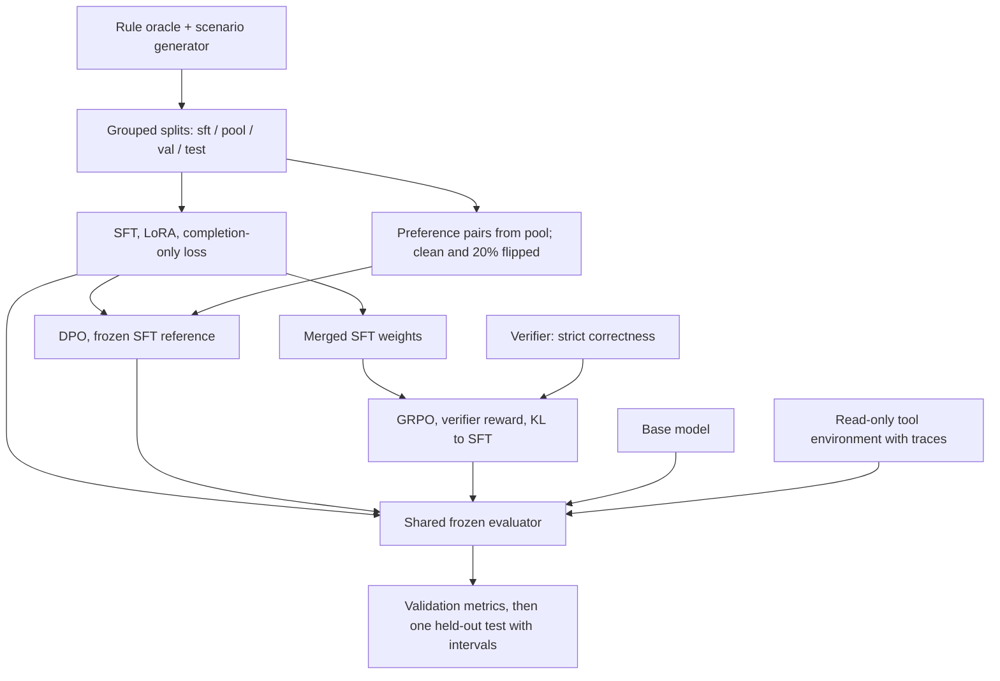

# Preference Lab

A small, reproducible experiment in post-training a language model: synthetic data, a rule-based answer checker, supervised fine-tuning (SFT), preference tuning (DPO), and a shared evaluation. It runs on a laptop (Apple M4, 16 GB) with a 0.5B-parameter model.

**Status: complete for the planned scope, with negative results.** Data, models, the tool environment and the one-time held-out test are done. Preference tuning and GRPO did not beat SFT. Trained tool use was not achieved. See RESULTS.md and docs/FINAL-STATUS.md. A read-only tool environment is built and tested, and the base and SFT models score 0 of 20 on it (see docs/TOOL-ENVIRONMENT.md). Nothing here is a claim about frontier-scale training. All data is synthetic.

## The task

A support agent gets a fictional return policy and a ticket, and must answer with JSON:

```json
{"action": "DENY", "evidence": ["L3", "L5", "L6"]}
```

`action` is ACCEPT, DENY or HOLD (HOLD only when a needed fact is unknown). `evidence` lists the exact policy and ticket lines that decide it. Example: an opened accessory returned on day 10 that is not faulty is a DENY. If the fault status is missing, it is a HOLD.

A small rule oracle (`oracle.py`) decides the right answer. A score of "correct" needs the right action **and exactly the right evidence lines**, so a well-formatted wrong answer scores nothing.

## What has been measured so far (validation set, 200 cases)

| Model | Strictly correct | Right action | Exact evidence |
|---|---|---|---|
| Base (Qwen2.5-0.5B-Instruct) | 0 / 200 | 27.5% | 0% |
| SFT, 1 epoch | 0 / 200 | 35% | 1% |
| SFT, 5 epochs | 25 / 200 (12.5%) | 60% | 16.5% |
| DPO from the SFT model (clean pairs) | 29 / 200 (14.5%) | 61.5% | 18% |
| DPO from the SFT model (20% flipped pairs) | 26 / 200 (13.0%) | 64.5% | 14% |
| GRPO from the SFT model (32 updates) | 23 / 200 (11.5%) | 59.5% | 15.5% |

Held-out test results (one run, all models frozen first): see RESULTS.md. The best model is about 12% strict correct, and no preference or RL step beats SFT beyond noise.

Read this carefully:
- The base model answers DENY about 80% of the time and never cites evidence.
- One epoch of SFT taught the format but collapsed to nearly always ACCEPT. Five epochs was chosen **after** seeing the validation result, so it is a validation-driven change to the original plan. Both runs are kept.
- DPO's gain over SFT is 4 cases out of 200 (11 wins, 7 losses on the same cases). That is within noise, so it is **not** shown to be better. It also shifted the model toward HOLD.
- Flipping 20% of the preference labels made no detectable difference: clean DPO beat corrupted DPO on 8 cases and lost on 5 (sign test p = 0.58). With 200 cases and one seed, small effects cannot be seen.
- The held-out test set has not been touched. These numbers are validation only, from one seed.

## How it is built

```
Scenario generator + independent rule oracle
        |
  grouped, leak-checked splits  (sft 400 / pool 1000 / val 200 / test 400 groups)
     |                 |
 SFT examples     preference pairs (clean, and 20% label-flipped copy)
     |                 |
 SFT model  ---->  DPO model (frozen SFT copy as reference)
     |
 same evaluator for every model
```

- Test cases include a held-out phrasing template and policy values never seen in training.
- Preference pairs use hard negatives (wrong action, missing, extra or made-up evidence), all valid JSON.
- The cross-check: a second, separately written oracle agrees with the first on every generated row, and a hand review of 40 rows (`docs/HAND-REVIEW.md`) found 40 of 40 agreements.


## Architecture



Track A (answer directly): SFT, DPO and GRPO are trained and tested this way.
Track B (tools): base and SFT are run through the tool environment; trained tool use is not achieved.

## Run it

```bash
uv venv --python 3.12 .venv && source .venv/bin/activate
uv pip install -e .                      # pinned versions are in requirements.lock.txt
python -m preference_lab.doctor          # hardware and speed check
python -m preference_lab.splits build    # data/ and a leakage audit
python -m preference_lab.pairs           # clean and corrupted preference pairs
python -m preference_lab.demo                  # five-minute demo from saved artifacts
python -m preference_lab.evaluate --split val --name base
python -m preference_lab.sft --name sft --epochs 5 --batch 8 --micro 2
python -m preference_lab.dpo --name dpo-clean --pairs data/pairs_clean.jsonl
python -m preference_lab.grpo --name grpo-speed --max-steps 10   # GRPO speed test
python -m pytest                         # 43 tests
python -m preference_lab.agent --scripted --name env-scripted   # tool-environment harness check
```

On a 16 GB Mac, set `PYTORCH_MPS_HIGH_WATERMARK_RATIO=0.6 PYTORCH_MPS_LOW_WATERMARK_RATIO=0.4` to cap GPU memory. Each run writes its config, log, predictions (failures included) and measured usage to `runs/<name>/`.

## Honest limits

- Labels come from a rule oracle, not human judgment, and the generator and oracle share assumptions.
- One seed, a tiny model and a few hundred examples. Differences of a few cases are noise.
- Calibration and confidence are not measured.
- Not shown here: research results, multi-GPU training, or production use.

See `docs/BENCHMARK.md` for measured speed and memory.
