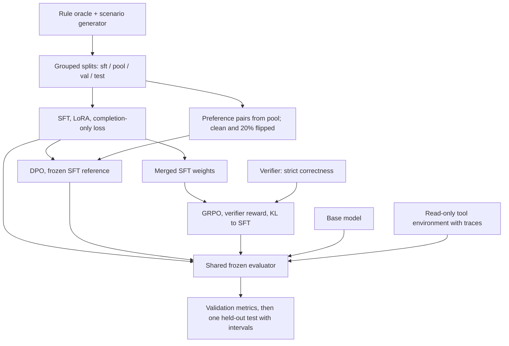

# Preference Lab

A small, reproducible experiment in post-training a language model: synthetic data, a rule-based answer checker, supervised fine-tuning (SFT), preference tuning (DPO), group-relative policy optimization (GRPO), a read-only tool environment, and a shared evaluation. It runs on a laptop (Apple M4, 16 GB) with a 0.5B-parameter model.

**Status: complete for the planned scope, with mostly negative results.**
- SFT clearly beat the untrained model. Neither DPO nor GRPO beat SFT beyond noise. Trained tool use was not achieved.
- The held-out test was run **once**, after the code and models were frozen (commit `a1a3e2e`). All five models finished and saved their predictions. The analysis step of that script then crashed, so the metrics were recomputed from the saved predictions, with no model rerun. Details in `RESULTS.md`.
- All data is synthetic. Nothing here is a claim about frontier-scale training or production use.

## The task

A support agent gets a fictional return policy and a ticket, and must answer with JSON:

```json
{"action": "DENY", "evidence": ["L3", "L5", "L6"]}
```

`action` is ACCEPT, DENY or HOLD (HOLD only when a needed fact is unknown). `evidence` lists the exact policy and ticket lines that decide it. Example: an opened accessory returned on day 10 that is not faulty is a DENY. If the fault status is missing, it is a HOLD.

A small rule oracle (`oracle.py`) decides the right answer. "Correct" needs the right action **and exactly the right evidence lines**, so a well-formatted wrong answer scores nothing.

## Results

### Held-out test (400 groups, 800 rows; run once)
Strict accuracy. Intervals are a group-level percentile bootstrap (2,000 resamples) and cover test-set sampling only, not training variance (one training seed per model).

| Model | Strict correct | 95% CI | Seen template | Held-out template |
|---|---|---|---|---|
| Base (no training) | 0.000 | [0.000, 0.000] (see note) | 0.000 | 0.000 |
| SFT (5 epochs) | 0.117 | 0.094 to 0.140 | 0.158 | 0.077 |
| DPO, clean pairs | 0.095 | 0.074 to 0.116 | 0.135 | 0.055 |
| DPO, 20% flipped pairs | 0.099 | 0.078 to 0.120 | 0.142 | 0.055 |
| GRPO (32 updates from SFT) | 0.120 | 0.096 to 0.144 | 0.163 | 0.077 |

Note on the base model: with zero successes, every bootstrap resample is also zero, so `[0, 0]` is not evidence of certainty. A plain exact calculation for 0 successes out of 800 rows gives a 95% upper bound of about 0.5% if rows were independent, and about 0.9% treating the 400 groups as the units. The saved metrics file is unchanged. See "Statistical notes" in `RESULTS.md`.

Paired differences on the same test groups: SFT beats base by 0.118 (CI 0.094 to 0.140). DPO clean minus SFT is -0.023 (CI -0.046 to +0.004), which leans negative but is not conclusive. Corrupted minus clean DPO is +0.004 (CI -0.020 to +0.026) and GRPO minus SFT is +0.003 (CI -0.003 to +0.008): no detectable difference. These are four unadjusted comparisons.

### Validation (200 cases; used for every choice before the test)
| Model | Strictly correct | Right action | Exact evidence |
|---|---|---|---|
| Base (Qwen2.5-0.5B-Instruct) | 0 / 200 | 27.5% | 0% |
| SFT, 1 epoch | 0 / 200 | 35% | 1% |
| SFT, 5 epochs | 25 / 200 (12.5%) | 60% | 16.5% |
| DPO from SFT (clean pairs) | 29 / 200 (14.5%) | 61.5% | 18% |
| DPO from SFT (20% flipped pairs) | 26 / 200 (13.0%) | 64.5% | 14% |
| GRPO from SFT (32 updates) | 23 / 200 (11.5%) | 59.5% | 15.5% |

Read this carefully:
- The base model answers DENY most of the time and never cites evidence.
- One epoch of SFT taught the format but collapsed to nearly always ACCEPT. Five epochs was chosen **after** seeing that validation result, so it is a validation-driven change to the original plan. Both runs are kept.
- On validation, DPO's gain over SFT was 4 cases of 200 (11 wins, 7 losses). That is within noise. On the held-out test DPO scored slightly lower than SFT. Neither supports "DPO helps".
- Flipping 20% of preference labels produced no detectable difference between the two DPO runs. This cannot rule out a small effect.
- GRPO's reward stayed almost flat and most update groups had no variation in reward. That is a plausible contributor to its lack of improvement, but it was not tested as the cause.
- Every model scores about half as well on the held-out phrasing template as on the seen ones.

## How it is built



- Splits are by underlying case (sft 400 / pool 1,000 / val 200 / test 400 groups), so no case appears in two splits. The test set also uses a held-out phrasing template and policy values unseen in training.
- Preference pairs use hard negatives (wrong action, missing, extra or made-up evidence), all valid JSON.
- Checks on the oracle: a second, separately written implementation agrees on every generated row, and a hand review of 40 rows (`docs/HAND-REVIEW.md`) found 40 of 40 agreements.
- Track A (answer directly) covers SFT, DPO and GRPO. Track B runs base and SFT through the tool environment (`docs/TOOL-ENVIRONMENT.md`); trained tool use is not achieved.

## Dashboard
`web/` is a static, read-only dashboard over the saved held-out results: the chart with 95% intervals and a seen vs held-out wording toggle, the paired differences, and an explorer of every saved answer. It has no backend and runs no model. Its `data.json` is derived from the saved files and checked against them (`python3 web/generate_data.py --check`). See [`web/README.md`](web/README.md).

```bash
python3 -m http.server 4174 --bind 127.0.0.1 --directory web     # then open http://127.0.0.1:4174
```

## What is in this repository, and what is not
GitHub has the code, 88 tests, the generated data, every run's config, logs, raw predictions and metrics, and the held-out test predictions. It does **not** have model weights: the adapters (17 MB or smaller) and the 1.9 GB merged SFT model are git-ignored. So a fresh clone can rerun the data pipeline, the tests, the demo and the saved-prediction analysis, but cannot evaluate the trained models without retraining them. The full inventory and the exact list of what runs from a fresh clone is in [`docs/ARTIFACTS.md`](docs/ARTIFACTS.md).

## Requirements
- **Hardware used:** Apple M4, 16 GB, macOS, GPU through PyTorch MPS. Measured peak GPU memory was 5.7 GB for SFT, 6.5 GB for DPO and 7.2 GB for GRPO. Linux, CUDA and CPU were not tested.
- **Downloads:** about 0.94 GB for the base model from Hugging Face (first use; cached afterwards) and about 1 GB for the Python environment. GRPO also writes a 1.9 GB merged model locally.
- **Python 3.12.** The lock file was produced on macOS arm64 and is not hash-pinned. Other platforms may resolve different builds of PyTorch.

## Setup (enforces the lock file)
```bash
uv venv --python 3.12 .venv && source .venv/bin/activate
uv pip sync requirements.lock.txt        # installs exactly the pinned versions, removes anything else
uv pip install -e . --no-deps            # the project itself, without re-resolving dependencies
python -m pytest                         # 88 tests
```
`uv pip install -e .` on its own does **not** use the lock file; it resolves the newest compatible versions.

Without uv: `python3.12 -m venv .venv && source .venv/bin/activate && pip install -r requirements.lock.txt && pip install -e . --no-deps`. In a fresh environment this installs the same pinned set.

## Run without retraining
```bash
python -m preference_lab.splits audit                       # leakage audit of the tracked data
python -m preference_lab.demo                               # five-minute demo from saved predictions
python -m preference_lab.test_analysis                      # recompute test metrics from saved predictions (prints only)
python -m preference_lab.test_analysis --check-against runs/test-results/test_metrics.json
python -m preference_lab.agent --scripted --name env-scripted-check   # tool-environment harness check, no model
python3 web/generate_data.py --check                        # the dashboard data matches the saved results
```

## Retrain (writes new weights; times measured on the M4)
```bash
export PYTORCH_MPS_HIGH_WATERMARK_RATIO=0.6 PYTORCH_MPS_LOW_WATERMARK_RATIO=0.4    # caps GPU memory on a 16 GB Mac
python -m preference_lab.doctor                                                      # hardware and speed check
python -m preference_lab.sft --name sft --epochs 5 --batch 8 --micro 2               # about 11 minutes
python -m preference_lab.dpo --name dpo-clean --pairs data/pairs_clean.jsonl         # about 13 minutes
python -m preference_lab.dpo --name dpo-corrupt --pairs data/pairs_corrupt.jsonl     # about 14 minutes
python -m preference_lab.grpo --name grpo --max-steps 32                             # about 3.5 minutes plus the merge
python -m preference_lab.evaluate --split val --name <model> --adapter runs/<model>/adapter
```
Training writes into `runs/<name>/`; use new names if you do not want to overwrite the tracked records. The held-out test runner (`final_test`) refuses to run again by design.

## Honest limits
- Labels come from a rule oracle, not human judgment, and the generator and oracle share assumptions.
- One training seed per method, a tiny model and a few hundred training examples. Small differences are noise.
- Calibration and confidence are not measured.
- Not shown here: research results, multi-GPU training, trained tool use, or production use.

See `docs/BENCHMARK.md` for measured speed and memory, and `RESULTS.md` for the full results and statistical notes.
